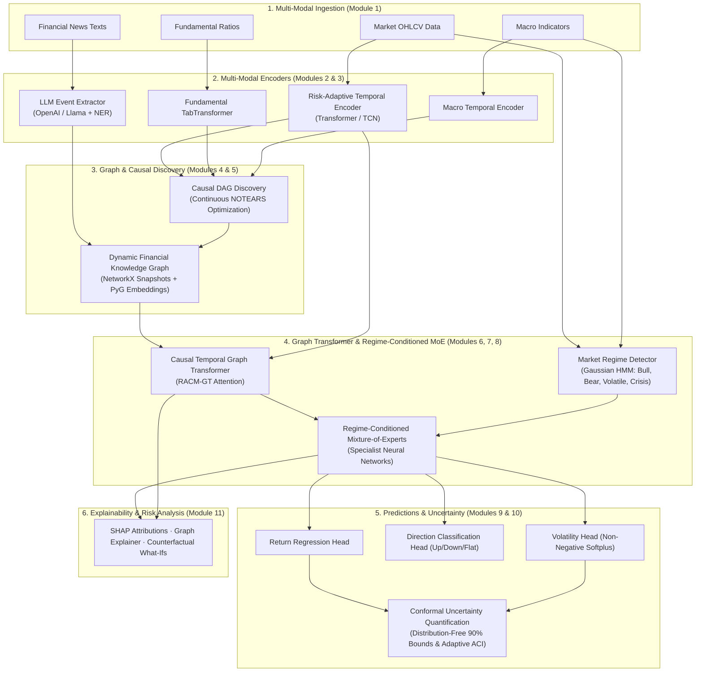
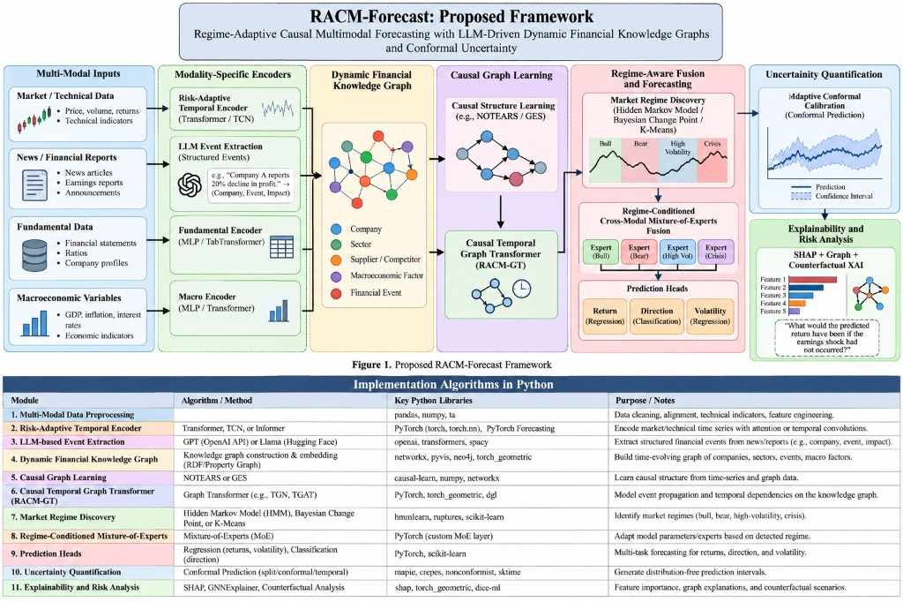

# RACM-Forecast

**Regime-Adaptive Causal Multimodal Forecasting with LLM-Driven Dynamic Financial Knowledge Graphs and Conformal Uncertainty**

A modular end-to-end financial forecasting framework that combines multi-modal data (market, news, fundamentals, macro) with causal graph learning, regime detection, and conformal prediction.

## Architecture





## Modules

| # | Module | Status |
|---|--------|--------|
| 1 | Multi-Modal Data Preprocessing | ✅ Done |
| 2 | Risk-Adaptive Temporal Encoder | ✅ Done |
| 3 | LLM-based Event Extraction | ✅ Done |
| 4 | Dynamic Financial Knowledge Graph | ✅ Done |
| 5 | Causal Graph Learning | ✅ Done |
| 6 | Causal Temporal Graph Transformer (RACM-GT) | ✅ Done |
| 7 | Market Regime Discovery | ✅ Done |
| 8 | Regime-Conditioned Mixture-of-Experts | ✅ Done |
| 9 | Prediction Heads | ✅ Done |
| 10 | Uncertainty Quantification | ✅ Done |
| 11 | Explainability and Risk Analysis | ✅ Done |

## Project Structure

```
racm-forecast/
├── config/              # YAML configs
├── data/                # Raw and processed data
├── preprocessing/       # Module 1 — loaders, alignment, features
├── encoders/            # Modules 2 & 3 — temporal, event extraction
├── knowledge_graph/     # Module 4 — graph construction & embedding
├── causal/              # Modules 5 & 6 — causal learning & RACM-GT
├── regime/              # Modules 7 & 8 — regime detection & MoE
├── prediction/          # Modules 9 & 10 — heads & uncertainty
├── explainability/      # Module 11 — SHAP, GNN, counterfactual
├── tests/               # Unit & integration tests
├── pipeline.py          # End-to-end pipeline
└── requirements.txt     # Dependencies
```

## Setup

```bash
git clone https://github.com/<your-username>/racm-forecast.git
cd racm-forecast
pip install -r requirements.txt
```

## Run Tests

```bash
python -m pytest tests/ -v
```

## License

MIT
